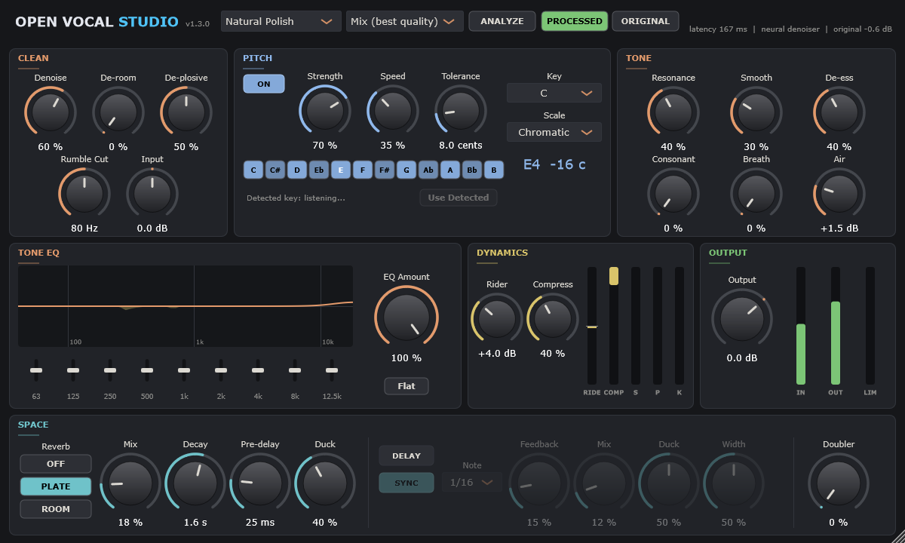

# Open Vocal Studio 1.3.0 (VST3 + standalone)

A complete lead-vocal channel for Windows in one plugin. It cleans up the recording (noise, room, plosives), corrects the pitch naturally, tames resonances, sibilance and harshness, sets the tone, controls the dynamics and adds a plate or room reverb and a short delay synced to your DAW.



**Download:** get the latest version from the [Releases](https://github.com/aloomens/open-vocal-studio/releases) page (the program zip, plus the source zip).

## License: free software (GNU AGPLv3)

Open Vocal Studio is free software, released under the **GNU Affero General Public License version 3** (see [LICENSE.txt](LICENSE.txt)). Copyright (C) 2026 Al Oomens.

- **You may** use it for anything, including commercial recordings, and share it with anyone.
- **If you share it**, pass on the license and offer the source code (share `OpenVocalStudio-<version>-source.zip` with the program zip).
- **If you change it and share your version**, your changes must be released under the same license.
- **There is no warranty.** See the license for the exact terms.

It's built with JUCE (AGPLv3), the Steinberg VST3 and ASIO SDKs (GPLv3) and the DeepFilterNet3 model (MIT / Apache-2.0); see [THIRD-PARTY-NOTICES.txt](THIRD-PARTY-NOTICES.txt). Click the **OPEN VOCAL STUDIO** title in the plugin to see the license notice.

## Quick start

1. Insert Open Vocal Studio on a vocal track (mono or stereo; it outputs stereo).
2. Pick a preset: **Natural Polish** (default), **Pop Lead**, **Intimate Ballad**, **Rock Lead**, **Spoken Word** or **Tracking (Low Latency)**.
3. Play 10–30 seconds of the vocal with **ANALYZE** on, then click it again. It sets the tone EQ to match a polished vocal curve and sets the key and scale for pitch correction.
4. Use the **PROCESSED | ORIGINAL** switch at the top to compare. The lit button is what you hear: PROCESSED (green) is Open Vocal Studio's sound, ORIGINAL (gold) is the untouched input. The original is level-matched, so louder never fools you into thinking it's better.
5. In the standalone app you can also open a recording, play it through Open Vocal Studio and save it processed (see **FILE** below).

## What's new in 1.3.0

- **Vocal Studio is now called Open Vocal Studio.** It's the same plugin, with the same ID, so your projects and presets load as before. The installer removes the old "Vocal Studio.vst3"; if you copy the plugin by hand, delete the old one yourself, or your DAW sees two copies. The standalone app asks for its audio device setup once, because its settings are kept under the new name.
- **A look shared with Clean Tone Studio and Open Mastering Studio:**
  - the title reads OPEN VOCAL in white and STUDIO in blue, with the version right after it;
  - section titles have a short underline;
  - knob values are plain text with their units ("60 %", "80 Hz", "+1.5 dB", "25 ms", "1.6 s", "8.0 cents"), and your DAW shows the same text;
  - buttons that stay lit are in capitals (ANALYZE, PROCESSED, ON, SYNC, LOOP); buttons that do something once are not: **Use Detected**, **Flat**, **Open...** and **Save Processed...**.
- **The info line** at the top right shows the latency, the denoiser in use and how far ORIGINAL is turned to match the processed level ("original −0.6 dB"). The mode is in the Mode box next to it.
- The sound hasn't changed: a THE_LAB run on 1.3.0 gives the same numbers as on 1.2.6.

## What's new in 1.2.6

- **Play a file and save it processed, in the standalone app.** A new FILE strip at the bottom of the standalone window (the plugin doesn't need one: it gets its audio from the DAW):
  - **OPEN...** loads a recording: WAV, AIFF, FLAC, MP3 or Ogg Vorbis, mono or stereo, up to 30 minutes.
  - **PLAY / STOP**, **LOOP** and a position bar you can click or drag. A file at a different sample rate from the sound card's is converted as it plays.
  - **SAVE PROCESSED** runs the whole file through a copy of the chain with the current settings. It writes a 24-bit stereo WAV at the file's own sample rate, with the latency taken out so it lines up with the original. When Reverb or Delay is on, 4 s are added at the end for the tail. It saves in the background, so you can keep listening.
  - **LIVE | FILE** chooses what you're processing. LIVE is the sound card's input, so singing through the app works exactly as before.
  - In the tests, playing a file gives exactly the same output as the same audio coming in through the input, and the saved file matches it sample for sample.
- **A/B is now a PROCESSED | ORIGINAL switch.** The lit button shows what you're hearing. The single A/B COMPARE button didn't show which one was playing.
- **USE DETECTED says what it did.** It's a one-shot button: it copies the detected key into Key and Scale, and the status line now confirms it ("Key set to A minor."). It's greyed out until a key has been detected. Clicked that early, it used to set C major without a word; now it says to sing a little longer and leaves Key and Scale alone.
- **The Doubler goes further.** The one knob now turns up three things together:
  - the copies' level, up to 3 dB below the voice (1.2.5 stopped at 6 dB below);
  - how far their timing wanders, up to ±3 ms (was ±1.6–2 ms);
  - and with it the slight detuning that a real second take has, up to about 8 cents, with a slower wander so it never warbles.

  Most of the extra is in the upper half of the knob; at 30 % it sounds much as before.

## Measuring Open Vocal Studio with THE_LAB

THE_LAB measures with noise, steady tones, sweeps and pink-noise "music". That's exactly what a vocal denoiser is built to remove. With **Denoise above 0**, in either mode:

- the sweep comes out 17–21 dB down;
- the steady tone is removed after a few seconds;
- the "music" is about 20 LU quieter;
- because the denoiser adapts to those signals over several seconds, THE_LAB also reports controls that "stay broken", a sound that "shifts" between sample rates, and a transport failure.

**The Doubler** above 0 trips THE_LAB too, for a different reason. Its two copies sit on slowly wandering delays, so the output is never quite the same twice. THE_LAB then can't measure a frequency response (every point reads the same), reports that left and right differ, finds sidebands around its test tone and flags controls as "staying broken".

How THE_LAB decides a control "stays broken": it compares the sound after the control returns with the sound before it moved, within one run. Anything that changes over time fails that, whichever control moved. With the Doubler at 100 %, THE_LAB even flagged Reverb Mix with the reverb off, Delay Mix with the delay off and Pitch Tolerance with pitch correction off: controls that do nothing in that setup.

All of this is by design: making those runs pass would make the denoiser worse at its job and the Doubler stop sounding like a second take.

**To measure the channel itself, set Denoise and Doubler to 0** (Doubler is 0 in every preset except Pop Lead). That's how every clean run below was made:

- 1.2.5, both modes, pitch correction on or off, and 1.2.6 and 1.3.0 in Mix mode: Stress GOOD, Software GOOD, 0 extremes failures;
- exact latency and bypass;
- identical output at every buffer size;
- sample rates within 0.3 dB.

This also explains two older THE_LAB findings I couldn't reproduce at the time: the 96 vs 48 kHz difference (1.1.0) and the −16 dB Track-mode sweep (1.2.0). Both disappear at Denoise 0.

With the Doubler at 100 %, the parts THE_LAB can judge are clean too: no clicks when controls move, identical output at every buffer size, after recall and in two instances, and sample rates within 0.5 dB.

## What's new in 1.2.5

- **New Consonant control** (TONE section, with a **K** meter under DYNAMICS). It softens the click of hard consonants (K, T, hard C) for just that moment, with a dynamic dip around 3.5 kHz. Vowels and sibilance are left to the other controls. In Mix mode it shares De-plosive's 3 ms look-ahead, so it adds no latency. In a test, a K burst comes out 6 dB (Track mode) to 8 dB (Mix mode) quieter at 100 %, and the vowels around it don't change. It starts at 0 %, so your projects and presets sound as before; try 30–50 % on a clicky take.
- **Reverb has a lit OFF / PLATE / ROOM switch** instead of a drop-down, like the PITCH ON and DELAY buttons. Controls of a section that's off are dimmed: the reverb's when Reverb is off, the delay's when Delay is off, and pitch correction's when it's off. You can still set them in advance.
- **The version is shown** under the VOCAL STUDIO title, and in the standalone app's title bar.
- **The first phrase after room tone isn't squashed any more.** The denoiser cleans room tone to near-silence. The rider and compressor used to learn that as the voice's level, then compress the first phrase hard while they caught up over several seconds. Now, when the level stays more than 12 dB above what they learned for 0.3 s, they take it at once. A short shout doesn't trigger this.
- **Pitch correction leaves tones above the singing range alone.** A whistle, a high-pitched whine or a test tone above about 1.1 kHz was taken for a low note (a multiple of its period) and pitch-shifted. Tones at 1.5–10 kHz now pass untouched.
- **The host shows the preset you picked.** A preset chosen in the plugin window used to leave the host showing the previous one.
- **Exactly the same output at every buffer size, also while Consonant, De-plosive, the EQ or the Rumble filter are moving.** They used to time their filter updates by the position inside the host's buffer.

## What's new in 1.2.1

After a THE_LAB measurement of 1.2.0 in Track mode (Denoise 60 %, pitch correction on), these were fixed:

- **Track mode no longer fades long notes.** Its spectral denoiser learned anything lasting more than about 2 s as noise, a held note included, and turned it down by up to 18 dB. (This release also said that was THE_LAB's −16 dB frequency response. It wasn't: that comes from the denoiser removing THE_LAB's own test signals; see "Measuring Open Vocal Studio with THE_LAB" above.) It now has the same voice guard as the neural denoiser: a sung note that stands well above the quietest moments of the last 6 s loses at most 2 dB. A steady tone through Track mode now loses 1.7 dB (1.2.0: 15.5 dB).
- **Pitch correction holds steady in noise.** Background noise pulled the pitch measurement sharp and now and then made it slip an octave, so on a noisy take the correction could wander by ±20 cents. Now:
  - the pitch is measured on a high-passed copy of the input;
  - a reading that jumps away for a frame or two is ignored (a real note change is followed after 30 ms).

  On a tone with noise only 15 dB down, the correction now stays within 2 cents of its target.
- **The rider and compressor follow a lasting level drop.** If the voice got more than 15 dB quieter for good (a quieter take, or the Input turned down), they kept the old level, so the compressor stopped compressing. After 2 s at the new level they now relearn it within about 4 s. The de-esser and smoothing got the same fix.
- **Pitch correction lines up again after a setting change.** On a steady tone, after Strength or Tolerance moved and came back, the output never lined up with an untouched copy again. While the pitch holds perfectly still, the shifted grains now drift onto a grid that depends only on the input (at most 0.2 % per period, inaudible). A sung voice never triggers this.

**What THE_LAB may still show, by design:**

- In Track mode, too, a constant tone counts as noise once it has lasted about 6 s, like a hum.
- If there's noise in the signal, pitch correction keeps the same pitch and level after Strength or Tolerance moves and comes back. Its waveform doesn't line up exactly with an untouched copy, though: the phase of a shifted signal depends on its history.

(Later runs showed that THE_LAB's "stays broken" results came from the denoiser, not from pitch correction: with Denoise at 0 and pitch correction on, THE_LAB reports no extremes failures.)

## What's new in 1.2.0

After a THE_LAB measurement of 1.1.0, these were fixed:

- **Stopping and starting the DAW no longer changes the level afterwards.** The denoiser keeps its state through digital silence and continues from the last full frame of signal. The rider and compressor hold their gain while the level falls away, and wait 0.4 s after silence before they relearn the voice's level. They also no longer ride up a fading phrase tail or a breath. After a 2 s stop, the level comes back within 0.7 dB of an uninterrupted run (1.1.0: up to 2 dB).
- **A constant buzz or hum is removed again.** In 1.1.0 the denoiser's voice guard could mistake a constant, tonal buzz for a voice and protect it. Now the guard measures the noise floor from every frame, so a steady buzz counts as noise: 38 dB of a 100 Hz buzz is removed. A sung note is still protected, because it stands well above the quieter frames between phrases. A long held note now loses about 4 dB through the whole default chain (1.1.0: 7 dB).

**What THE_LAB will still show, by design.** Open Vocal Studio is built to keep the voice and remove everything else, and THE_LAB measures with test tones, sweeps and noise, which aren't a voice.

- At the default Denoise of 60 %, a constant test tone or sweep is treated like hum or whine and turned down by up to about 24 dB. THE_LAB reports this as a low gain at 1 kHz and as "level-dependent" or "time-variant".
- Pitch correction moves a 999.76 Hz test tone toward B5 (987.77 Hz), which THE_LAB lists as a non-harmonic peak at 995 Hz.
- The output limiter (−1 dBTP) turns down test signals that peak near 0 dBFS.

To measure the channel itself, set Denoise to 0 and turn pitch correction off.

THE_LAB also reported an 18.6 dB difference at 960 Hz between 96 and 48 kHz. I couldn't reproduce it. With white and pink noise at −12 to −40 dBFS, measured over the first seconds or later, every stage matches within 0.2 dB. The exception is the neural denoiser, which differs by up to 4 dB, and only in bands below 200 Hz where it has already removed 16–40 dB of the noise.

## What's new in 1.1.0

After a THE_LAB measurement of 1.0.0, these were fixed:

- **The neural denoiser runs inside the plugin.** Open Vocal Studio now has its own DeepFilterNet3 engine instead of ONNX Runtime. It runs frame by frame on the audio thread, and its output matches the original model in ONNX Runtime to within 0.000002. That gives:
  - **no memory allocation while audio plays** (1.0.0 allocated in every buffer);
  - **the same output on every run and at every buffer size** (1.0.0 could differ when a DAW rendered faster than real time);
  - **Mix-mode latency of about 167 ms instead of 637 ms**;
  - **no 20 MB DLL** in the package.
- **Steady notes and test tones survive.** The denoiser's voice guard now recognizes tonal frames. The resonance control only reacts to what rises above the voice's usual shape, so a steady tone isn't treated as a resonance.
- **Pitch correction:**
  - It leaves the first 60 ms of each note alone, until it can tell a held note from a glide.
  - After a correction it drifts back into exact alignment with the input. In 1.0.0 a sweep could come out time-shifted, which THE_LAB read as inverted polarity.
  - Its tiny DC offset is gone: the rumble filter now comes after it.
- **New tests** (VocalTest) reproduce THE_LAB's checks: a steady tone, sweep polarity, Rumble Filter extremes, 48 vs 96 kHz on noise, run-to-run repeatability and a count of memory allocations in the audio callback.

**By design:** Open Vocal Studio processes the voice in mono. A stereo input is summed, so a left-only input also comes out on the right, which THE_LAB reports as channel leakage. The doubler, delay and reverb are stereo around the mono voice.

## Two modes

| Mode | Latency (48 kHz) | Use it for |
|---|---|---|
| **Mix (best quality)** | about 167 ms, reported to the DAW, which compensates automatically | Mixing. Uses the neural denoiser and the finest analysis. |
| **Track (low latency)** | 5.8 ms with pitch correction off, 55 ms with it on | Recording through the plugin. Spectral denoiser and shorter analysis windows. |

Cubase and other DAWs compensate plugin latency on playback, so in Mix mode everything stays in time. Don't monitor a live singer through Mix mode. Switch to Track mode (or the Tracking preset) while recording, then back to Mix.

## Signal chain

The vocal is processed in mono (a voice is a mono source); the doubler, delay and reverb are stereo around it.

**Input → Rumble filter → Denoise → De-plosive + Consonant → Pitch → [Spectral stage: De-room, Resonance, Smooth, De-ess, Breath] → Tone EQ + Air → Rider → Compressor → Doubler / Delay / Reverb → Output → True-peak limiter (−1 dBTP)**

### CLEAN

- **Denoise**: removes noise, hum, hiss, room tone and headphone bleed around the voice.
  - In Mix mode it uses **DeepFilterNet3**, a neural network trained to separate a voice from noise. Open Vocal Studio runs it with its own streaming engine: about 0.36 ms of work per 10 ms frame (under 4% of one CPU core). It adds 40 ms of latency, never allocates memory, and gives the same result every time.
  - A **voice guard** stops it from thinning long, steady sung notes. A frame that is clearly a voice (far above the noise floor, or tonal) can lose only 2-3 dB; gaps and noise get the full cleanup.
  - In Track mode (or if the neural engine can't load) it uses a classic spectral denoiser (minimum statistics with a Wiener gain), with the same voice guard.
- **De-room**: pulls back room reflections and reverb recorded with the voice (late-reverberation suppression).
- **De-plosive**: detects low-frequency bursts (P, B) and applies a dynamic low shelf only during them. At rest it's exactly flat. In Mix mode a 3 ms look-ahead catches the start of the burst.
- **Rumble Cut**: 24 dB/oct high-pass, 20–300 Hz (default 80 Hz).
- **Input**: gain before everything.

### PITCH

Natural pitch correction: it corrects the **center** of each note and leaves how it's sung alone.

- **Pitch tracking:** YIN at about 12 kHz, refined at the full sample rate, so it's sub-cent accurate up to high notes. It works on a high-passed copy of the input, so low-frequency noise can't pull it sharp. A reading that jumps away for a frame or two (an octave slip in noise or breath) is ignored.
- **Note center:** a slow average of the sung pitch is pulled toward the nearest allowed note. Vibrato, scoops and expressive bends stay exactly as sung.
- **Slides** (pitch moving faster than about 4 semitones/s) fade the correction out, so glides between notes sound natural.
- **Shifting:** TD-PSOLA. It shifts the pitch without moving the formants, so the voice keeps its character, with sub-sample grain placement. With Strength at 0 the corrector is bit-transparent.

The controls:

- **Strength**: how far an off note is pulled. 100% means all the way.
- **Speed**: how quickly the correction follows. Low settings fix only the long-term intonation, the most invisible kind.
- **Tolerance**: deviations smaller than this many cents are left alone.
- **Key / Scale**: choose from Chromatic, Major, Minor, Harmonic Minor, Melodic Minor, Major and Minor Pentatonic, Blues, Dorian and Mixolydian. **ANALYZE** or **Use Detected** sets them from the Krumhansl–Kessler key detector. Use Detected copies the key once, and is greyed out until a key has been detected; the detected key is shown next to it.
- **Note buttons**: turn a note off to keep the correction away from it.
- **Readout**: the current note and how many cents are being corrected.

### TONE

- **Resonance**: finds narrow regions that ring above the voice's own usual shape and turns them down only while they ring. The voice's steady formants are left alone, and so are its harmonics (the analysis is smoothed across frequency).
- **Smooth**: softens a harsh 2–5 kHz edge when it pokes out relative to the rest of the voice.
- **De-ess**: reduces only the sibilant band (above about 4.5 kHz) when an S is louder than the voice's usual level. The rest of the voice isn't dulled.
- **Consonant**: softens the click of hard consonants (K, T, hard C). It reacts to a short burst in the 1.8–9 kHz band that rises suddenly and carries most of the sound at that moment, and dips around 3.5 kHz for just that moment. A vowel's onset doesn't qualify, and a held S only at its very start (De-ess handles the rest). At 0 % (the default) it's exactly flat.
- **Breath**: turns down long, quiet, noise-like breaths between phrases.
- **Air**: high shelf above 12 kHz.

### TONE EQ

Nine bands an octave apart (63 Hz to 8 kHz, plus a 12.5 kHz shelf). **ANALYZE** measures the long-term spectrum of the voice and fits the bands toward a reference curve for a finished lead vocal. The match is 80% of the difference, at most ±6 dB per band, and it never boosts the deep lows. You can edit the bands afterwards. **EQ Amount** scales them; **Flat** resets them. The display shows the EQ curve, with the live reduction of the spectral stage shaded underneath.

### DYNAMICS

- **Rider**: evens out the level between phrases (up to the set range in dB) before the compressor, so the compressor can work gently.
- **Compress**: vocal compressor whose threshold follows the voice's own level, so the same setting gives the same control at any input level. Both the rider and the compressor follow a lasting change of level: a drop after 2 s, a jump of more than 12 dB after 0.3 s (the voice coming in after room tone). A single quiet word or a short shout doesn't move them.
  - Soft knee.
  - Program-dependent release: short peaks recover fast, sustained compression slowly.
  - Automatic make-up gain.

The meters show the rider's gain, the compressor's reduction, de-essing (S), de-plosive (P) and Consonant (K).

### SPACE

- **Reverb**: the **OFF / PLATE / ROOM** switch shows the active choice lit.
  - **Plate** is bright and dense, with no early reflections.
  - **Room** is shorter and darker, with early reflections.
  - **Off** turns it off; its controls are then dimmed (as are the delay's when Delay is off, and pitch correction's when it's off).
  - Both are a 16-line feedback delay network with frequency-dependent decay. Controls: Mix, Decay, Pre-delay and **Duck** (the reverb backs off while the voice sings and blooms in the gaps).
- **Delay**: a short slap delay.
  - Free time is 60–150 ms. With **SYNC** on, it follows the DAW tempo with note values from 1/64 to 1/8, including triplets and dotted values.
  - Controls: Feedback, Mix, Duck and Width (ping-pong).
- **Doubler**: double-tracked width, made from two short (12 and 19 ms), slowly wandering delays panned left and right. The knob raises the copies' level (up to 3 dB below the voice), how far their timing wanders (up to ±3 ms) and, with it, their slight detuning (up to about 8 cents). Low settings give a subtle width, high settings a clear second take.

### OUTPUT

Output gain, input/output meters and the true-peak limiter (−1 dBTP, 4× oversampled detection) that keeps the plugin from ever clipping.

### FILE (standalone app only)

The strip at the bottom of the standalone window plays a recording through Open Vocal Studio and saves it processed.

- **LIVE | FILE**: what you process. LIVE is the sound card's input; FILE is the loaded recording.
- **Open...**: WAV, AIFF, FLAC, MP3 or Ogg Vorbis, mono or stereo, up to 30 minutes. A file at a different sample rate from the sound card's is converted as it plays.
- **PLAY / STOP**, **LOOP**, and the position bar (click or drag to move).
- **Save Processed...**: the whole file through a copy of the chain with the current settings, as a 24-bit stereo WAV at the file's own sample rate. The latency is taken out, so the result lines up with the original. With Reverb or Delay on, 4 s are added at the end for the tail. Saving runs in the background, and the status line shows its progress.

For a sample-exact line-up with the original, use WAV, AIFF or FLAC: Windows' MP3 decoder keeps the encoder's short silence (a few tens of milliseconds) at the start of the file.

## Measurements and tests

Measured results are in [Reports/measurements.md](Reports/measurements.md). Run `VocalTest.exe --lab Reports\measurements.md` to regenerate them. The tests cover:

- **Latency:** reported equals measured in both modes at 44.1, 48 and 96 kHz.
- **Transparency:**
  - neutral settings null to −137 dB at 48 kHz;
  - the output is bit-identical at any host block size, also while Consonant and De-plosive are at work;
  - silence in gives silence out.
- **Safety:**
  - no clicks when any control jumps from one end to the other;
  - the true peak stays under −1 dBTP with every control at maximum;
  - no NaN or Inf values.
- **Each processor:**
  - pitch correction lands off notes within about 1 cent;
  - the de-esser takes 7.5 dB off sibilance and leaves the vowels alone;
  - the de-plosive takes 10 dB off a thump;
  - Consonant takes 6–8 dB off the burst of a K and leaves the vowels within 0.3 dB;
  - the denoisers raise the SNR on real speech;
  - a long, steady note survives the cleanup, in both modes;
  - pitch correction holds a tone in noise within 3 cents of its target;
  - the rider and compressor follow a lasting level drop, and don't squash the first phrase after room tone;
  - pitch correction leaves tones above the singing range alone;
  - after a pitch setting moves and returns, a steady tone lines up with an untouched copy again;
  - Analyze finds the key and fixes the tone of a deliberately boxy, dull voice; Use Detected leaves Key and Scale alone until a key has been detected.
- **File player (standalone):** a played file gives exactly the same output as the same audio through the input; Save Processed matches live processing sample for sample with the latency taken out; a 44.1 kHz file plays at the right pitch and level at 48 kHz. `VocalTest.exe --diag-load <files>` opens files with the app's loader (WAV, AIFF and FLAC load bit-exact).
- **Recall and CPU:** state recall and the CPU cost per mode.

Also:

- `PitchCheck.exe` checks the pitch corrector on its own.
- `DfnCheck.exe` checks the neural engine on its own (chunked streaming against one-pass processing, and against the original model in ONNX Runtime).
- `PluginHostTest.exe "…\Open Vocal Studio.vst3"` loads the finished VST3 the way a DAW does.

## Building

You need Visual Studio 2022 (Build Tools) and CMake 3.22 or newer. Unpack the source to a short path such as `C:\src`, because deep folders run into Windows' 260-character path limit.

```powershell
cmake -B build -G "Visual Studio 17 2022" -A x64
```

```powershell
cmake --build build --config Release
```

```powershell
pwsh -File Tools\package.ps1
```

`external/` holds JUCE 8.0.4, the ASIO SDK and the DeepFilterNet3 ONNX model files, which the build embeds in the plugin.

From the GitHub repository, JUCE comes in as a git submodule (pinned to 8.0.4), so clone with `--recursive`, or run `git submodule update --init` after a plain clone. The source zip on the Releases page already contains everything.

The source zip also holds ONNX Runtime 1.32.0 in `external/onnxruntime` (headers and the Windows x64 DLL from Microsoft's NuGet package); the git repository leaves it out. Only the `DfnCheck` developer test uses it, to check Open Vocal Studio's own engine against the original model, and the build skips that test when it's missing. The plugin and app don't contain it.
